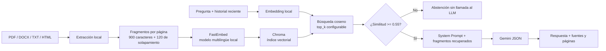

# Tutor TOGAF — Avance 2

Asistente académico para consultar extractos de **TOGAF 9.1** mediante recuperación
aumentada por generación (RAG). El proyecto conserva el System Prompt del Avance 1,
incluye ejemplos Few-Shot y devuelve respuestas JSON con el tema, explicación, ejemplo
y nivel. La interfaz muestra por separado los documentos y páginas recuperados.

## Alcance del corpus

El corpus disponible para esta entrega está compuesto por seis extractos:

- Introducción al ADM.
- Fase preliminar.
- Fase A: Architecture Vision.
- Fase B: Business Architecture.
- Fase C: Data Architecture.
- Fase C: Application Architecture.

La fase D y otros capítulos no están incluidos. El tutor debe reconocer esa limitación
y abstenerse cuando los fragmentos recuperados no permitan responder.

Los PDF suministrados incluyen la marca **“Evaluation Copy. Not for redistribution”**.
Por ese motivo no se guardan en GitHub. Para ejecutar el proyecto, copia tus archivos
autorizados en `data/source_documents/`; en la app desplegada, cada persona carga sus
documentos durante su propia sesión.

## Flujo RAG



### Decisiones técnicas

| Componente | Decisión | Motivo |
| --- | --- | --- |
| Extracción | `pypdf`, `python-docx` y BeautifulSoup | Lee PDF, DOCX, TXT y HTML sin enviar los archivos a Gemini. |
| Chunking | 900 caracteres, solapamiento de 120; no cruza páginas de PDF | Conserva pasajes cortos y su referencia de página; el solapamiento reduce cortes en límites de fragmento. |
| Embeddings | `sentence-transformers/paraphrase-multilingual-MiniLM-L12-v2` mediante FastEmbed/ONNX | Modelo multilingüe local para preguntas en español y documentos mayormente en inglés; no requiere llamadas de embeddings a una API. |
| Índice | Chroma con distancia coseno | Persiste localmente en `data/chroma/`; la app usa una colección temporal por sesión. |
| Recuperación | similitud coseno, umbral inicial 0.55 y `top_k=5` | Solo se conserva el conjunto recuperado; el umbral y `top_k` son configurables. |
| Generación | Google GenAI con `gemini-3.5-flash-lite` por defecto | Mantiene el System Prompt, Few-Shot, delimitadores y formato JSON del Avance 1. |

Los parámetros 900/120 y el umbral 0.55 son la configuración inicial documentada. La
evaluación compara `top_k=3` (línea base) con `top_k=5` (candidata), manteniendo iguales
los demás parámetros. La candidata solo debe llamarse “mejora” si los resultados Ragas
lo respaldan.

## Privacidad y servicios externos

- Los embeddings y la búsqueda se ejecutan localmente. La primera ejecución descarga el
  modelo de embeddings desde Hugging Face; los documentos no se cargan allí.
- Al usar la app pública, el navegador envía los archivos cargados al servidor de
  Streamlit para procesarlos en memoria durante la sesión. La aplicación no los guarda
  en el índice persistente del servidor.
- Solo la pregunta, el historial reciente y los fragmentos recuperados se envían a
  Gemini para generar una respuesta. La evaluación Ragas también envía a Gemini las
  preguntas, respuestas, referencias y contextos recuperados para calificarlos.
- **Usa una clave de Gemini de un proyecto con facturación activa.** Google indica que
  el nivel gratuito puede usar entradas y respuestas para mejorar sus productos; en el
  nivel de pago no se usan para ese fin. Las llamadas se facturan por tokens y el nivel
  de pago requiere asociar facturación; revisa las [condiciones y tarifas vigentes de
  Gemini](https://ai.google.dev/gemini-api/docs/billing) antes de ejecutar la evaluación.
- Nunca agregues `.env`, `secrets.toml`, índices locales ni los PDF fuente a Git.

## Instalación local

Se recomienda Python 3.12.

```powershell
git clone https://github.com/SharonKarina/Tutor-TOGAF.git
cd Tutor-TOGAF
python -m venv .venv
.\.venv\Scripts\Activate.ps1
python -m pip install -r requirements.txt
Copy-Item .env.example .env
```

Edita `.env` localmente y asigna una clave de Gemini de un proyecto con facturación
activa. No pegues la clave en GitHub ni en el chat.

Copia los seis archivos TOGAF a `data/source_documents/`. Para crear o actualizar el
índice local persistente:

```powershell
python -m scripts.build_index
```

Ejecuta el modo de consola:

```powershell
python -m src.main
```

La primera carga de embeddings puede descargar aproximadamente 220 MB desde Hugging
Face. El texto y los vectores resultantes se guardan en el equipo, bajo `data/chroma/`.

## Interfaz conversacional

Inicia Streamlit desde la raíz del repositorio:

```powershell
streamlit run app.py
```

En el panel lateral, carga los documentos y selecciona **Crear índice de esta sesión**.
La conversación conserva turnos para resolver preguntas de seguimiento. En cada
respuesta, abre **Fuentes consultadas** para revisar nombre de archivo, página y
fragmento utilizado. El índice de la app se mantiene en memoria durante la sesión.

## Evaluación Ragas

`evaluation/questions.json` contiene 18 preguntas redactadas para los seis extractos:
15 con respuesta en el corpus y 3 sin respuesta disponible. Cada pregunta incluye una
respuesta de referencia y, cuando corresponde, el PDF y la página esperados.

La evaluación ejecuta ambos valores de `top_k` y calcula **faithfulness**,
**answer_relevancy**, **context_precision** y **context_recall**. También genera un
resumen de control de abstenciones para los casos ausentes del corpus.

```powershell
python -m scripts.evaluate_ragas
```

Para una ejecución piloto, puedes limitar el número de preguntas antes de lanzar la
comparación completa:

```powershell
python -m scripts.evaluate_ragas --limit 3
```

La ejecución completa puede generar solicitudes a Gemini tanto para responder las
preguntas como para juzgar las métricas Ragas. Los resultados y textos intermedios se
guardan localmente bajo `evaluation/results/`, carpeta excluida de Git. No incluyas
fragmentos del corpus ni archivos intermedios en un repositorio público.

## Despliegue público

1. Confirma que el código esté en `main` del repositorio de GitHub.
2. Entra a [Streamlit Community Cloud](https://share.streamlit.io/) e inicia sesión con
   GitHub.
3. Crea una app desde el repositorio `SharonKarina/Tutor-TOGAF`, rama `main` y archivo
   de entrada `app.py`.
4. Selecciona Python 3.12 y agrega `GEMINI_API_KEY` en los secretos de la app; no la
   agregues a un archivo del repositorio.
5. Despliega, verifica que el arranque termine y carga los PDF desde la interfaz.
6. Copia la URL que Streamlit asigne y actualiza la sección siguiente.

**URL pública de la app:** pendiente de despliegue en la cuenta de Streamlit.

**Repositorio GitHub:** <https://github.com/SharonKarina/Tutor-TOGAF>

## Archivos principales

- `app.py`: interfaz de chat para Streamlit.
- `src/rag/documents.py`: extracción y chunking con metadatos de fuente/página.
- `src/rag/embeddings.py`: embeddings FastEmbed locales.
- `src/rag/vector_store.py`: índice Chroma persistente o temporal.
- `src/rag/pipeline.py`: recuperación, umbral y abstención.
- `src/rag/generation.py`: integración Gemini y salida JSON.
- `prompts/system_prompt.py`: System Prompt y ejemplos Few-Shot del tutor.
- `scripts/build_index.py`: construcción local del índice persistente.
- `scripts/evaluate_ragas.py`: comparación Ragas antes/después.
- `evaluation/questions.json`: 18 preguntas y respuestas de referencia.
- `data/source_documents/README.md`: cómo preparar el corpus privado.
